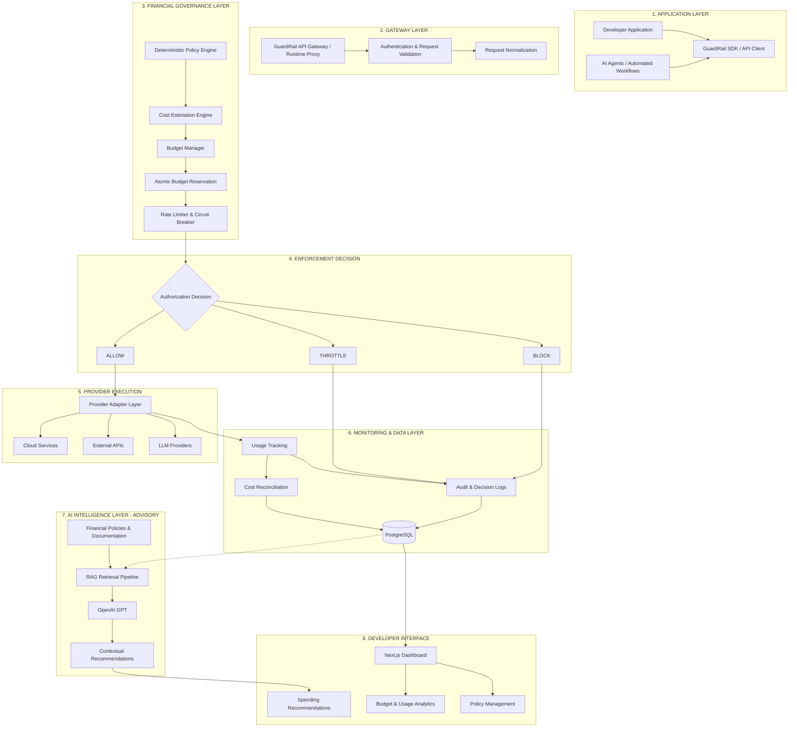

# GuardRail – Agentic Spend Firewall

**A Financial Governance and Runtime Enforcement Platform for Cloud Services, APIs, and AI Agents.**

GuardRail is a developer-focused financial governance platform designed to prevent unexpected infrastructure costs through real-time usage monitoring, deterministic policy enforcement, budget controls, and circuit breakers.

Unlike traditional cost-monitoring solutions that report expenses after they occur, GuardRail introduces a runtime enforcement layer between applications and external service providers. It evaluates requests against predefined financial policies before execution, helping developers prevent excessive spending and maintain control over resource consumption.

---

## 1. Problem Statement

Modern applications increasingly depend on paid cloud infrastructure, third-party APIs, and Large Language Models (LLMs). However, uncontrolled resource consumption can result in unexpected financial costs.

Some common challenges include:

- **Runaway AI Agents:** Repeated tool calls and infinite execution loops can consume excessive LLM tokens.
- **Uncontrolled API Consumption:** Applications may generate excessive requests without proper usage restrictions.
- **Unexpected Cloud Bills:** Forgotten resources and continuously running services can accumulate costs.
- **Lack of Runtime Protection:** Traditional monitoring systems often identify excessive spending only after resources have been consumed.
- **Limited Financial Visibility:** Developers lack a unified mechanism to monitor budgets, estimate costs, and enforce spending policies.

GuardRail addresses these challenges by moving financial governance from post-execution monitoring to proactive runtime enforcement.

---

## 2. Proposed Solution

GuardRail acts as an API Gateway and Runtime Enforcement Proxy between developer applications and external service providers.

Before forwarding a request, GuardRail evaluates its estimated cost, available budget, usage limits, and applicable policies.

Its core capabilities include:

- **Runtime Authorization:** Evaluates requests against predefined spending policies before execution.
- **Budget Management:** Enforces configurable spending limits at application, project, or agent level.
- **Cost Estimation:** Estimates potential request costs using provider pricing information.
- **Circuit Breakers:** Interrupts excessive or repeated requests to prevent runaway expenditure.
- **Usage Monitoring:** Tracks API consumption and resource utilization.
- **AI-Assisted Intelligence:** Uses LLMs and Retrieval-Augmented Generation (RAG) to retrieve relevant policies and generate contextual recommendations.

**Core Design Principle:** Financial authorization is controlled by deterministic backend logic. LLMs provide advisory intelligence but never independently authorize spending or override enforcement policies.

---

## 3. System Architecture

GuardRail follows a layered architecture that separates request interception, financial authorization, execution, monitoring, and AI-assisted intelligence.

### 3.1 High-Level Architecture

### 3.2 Request Execution Workflow

1. **Request Initiation:** A developer application or AI agent sends a request through the GuardRail SDK or API gateway.

2. **Request Validation:** The gateway authenticates the request and normalizes its metadata, provider, application identity, and resource requirements.

3. **Policy Evaluation:** The deterministic policy engine checks applicable spending limits, permissions, and usage restrictions.

4. **Cost Estimation:** The cost estimation engine calculates the expected request cost using provider pricing information.

5. **Budget Reservation:** The budget manager checks available funds and reserves the estimated amount using atomic database operations to prevent concurrent requests from overspending.

6. **Enforcement Decision:** The enforcement layer determines whether the request should be allowed, throttled, or blocked.

7. **Provider Execution:** Authorized requests are forwarded through the appropriate provider adapter to the external service.

8. **Usage Tracking:** Actual consumption and associated costs are recorded for financial monitoring and reconciliation. Unused reservations are released or adjusted.

9. **AI-Assisted Analysis:** The RAG pipeline retrieves relevant financial policies and documentation, while the LLM generates contextual explanations and recommendations.

10. **Developer Visibility:** The dashboard presents usage information, budget utilization, policy decisions, and spending insights.

---

## 4. Key Features

### 4.1 Deterministic Policy Engine

- Evaluates incoming requests against predefined financial policies.
- Supports configurable budget and usage restrictions.
- Makes predictable allow, throttle, and block decisions.
- Prevents LLM-generated recommendations from bypassing financial authorization.

### 4.2 Budget Management

- Supports configurable spending limits.
- Tracks budget utilization across applications and projects.
- Estimates request costs before execution.
- Uses atomic budget reservations to handle concurrent requests safely.
- Prevents multiple simultaneous requests from exceeding available budgets.

### 4.3 Circuit Breakers and Rate Limiting

Circuit breakers provide an additional layer of protection against uncontrolled resource consumption.

- Detect excessive API requests and repeated execution patterns.
- Apply request throttling when configured usage thresholds are reached.
- Block requests when financial policies are violated.
- Interrupt runaway agent execution to prevent unnecessary expenditure.
- Support controlled recovery when usage conditions return within permitted limits.

### 4.4 Cost Estimation and Usage Analytics

- Tracks API requests and resource consumption.
- Estimates expenditure using provider-specific pricing information.
- Maintains structured usage and cost records.
- Identifies potential budget overruns.
- Supports financial reporting and resource optimization.

### 4.5 LLM and RAG Integration

GuardRail incorporates AI-assisted intelligence to make financial governance more context-aware.

**LLM Integration:**
- Interprets developer questions about spending and financial policies.
- Generates contextual explanations and recommendations.
- Helps developers understand usage patterns and policy violations.

**Retrieval-Augmented Generation (RAG):**
- Retrieves relevant financial policies and provider documentation.
- Supplies contextual information to the LLM.
- Reduces unsupported recommendations by grounding responses in retrieved information.
- Provides policy-related guidance without giving the LLM authority over enforcement decisions.

---

## 5. Technology Stack

| Layer | Technology | Purpose |
|---|---|---|
| Programming Language | Python | Backend logic and enforcement |
| Backend Framework | FastAPI | REST APIs and request processing |
| Frontend | Next.js, React.js | Developer dashboard |
| Database | PostgreSQL | Policies, budgets, usage and financial records |
| AI Integration | OpenAI GPT | Contextual analysis and recommendations |
| Retrieval | RAG | Financial policy and documentation retrieval |
| Enforcement | Python-based Policy Engine | Deterministic authorization |
| Reliability | Circuit Breakers, Rate Limiting | Control excessive resource consumption |
| Containerization | Docker | Application packaging and deployment |

---

## 6. Database Design

PostgreSQL serves as the primary structured data store.

The intended database entities include:

| Entity | Responsibility |
|---|---|
| Users | Developer identity and access information |
| Projects | Applications and projects registered with GuardRail |
| Policies | Configurable financial and usage restrictions |
| Budgets | Spending limits and utilization |
| Reservations | Temporary budget allocations for pending requests |
| Usage Events | API consumption and resource usage records |
| Provider Pricing | Cost information for supported services |
| Policy Decisions | Authorization, throttling, and blocking history |
| Audit Logs | Traceable records of enforcement activities |

The database design supports financial accountability, request traceability, and consistent budget enforcement.

---

## 7. Security and Reliability Principles

1. **Fail-Closed Enforcement:** Requests must not bypass financial authorization when policy validation or budget verification fails.

2. **Deterministic Authorization:** Critical financial decisions are handled by backend rules rather than probabilistic LLM outputs.

3. **Atomic Budget Reservations:** Concurrent requests must not reserve more than the available budget.

4. **Separation of Concerns:** Request processing, financial enforcement, provider execution, analytics, and AI intelligence operate as separate logical components.

5. **Auditability:** Policy decisions and usage events should be traceable for verification and financial reconciliation.

6. **Proactive Protection:** GuardRail aims to prevent excessive spending before it accumulates into unexpected financial liabilities.

---

## 8. Implementation Status

GuardRail is being developed incrementally, with a focus on building a reliable financial enforcement foundation before expanding provider integrations.

| Component | Status |
|---|---|
| Python / FastAPI backend foundation | In Progress |
| Financial policy engine | In Progress |
| Budget evaluation and enforcement | In Progress |
| API Gateway / Runtime Proxy | Planned |
| Atomic budget reservations | Planned |
| Circuit breakers and throttling | Planned |
| PostgreSQL usage and cost tracking | Planned |
| Cost estimation and analytics | Planned |
| OpenAI GPT integration | Planned |
| RAG-based policy retrieval | Planned |
| Next.js developer dashboard | Planned |
| Provider-specific integrations | Planned |

*Update these statuses as individual components are implemented and tested.*

---

## 9. Expected Impact and Outcomes

GuardRail aims to deliver measurable improvements in financial governance and infrastructure cost control.

- **Reduced Unexpected Costs:** Prevents requests that violate configured spending policies.
- **Controlled AI Consumption:** Protects against runaway agent loops and excessive LLM usage.
- **Improved Resource Management:** Helps developers identify unnecessary API consumption and optimize usage.
- **Financial Transparency:** Provides visibility into spending patterns, budget utilization, and resource consumption.
- **Reliable Enforcement:** Uses deterministic policies and circuit breakers to make financial controls predictable.
- **Scalable Governance:** Establishes a reusable enforcement layer for applications, teams, and autonomous agents.

---

## 10. Future Scope

- Support for AWS, Azure, and other cloud service providers.
- Integrations with OpenAI, Gemini, and other LLM APIs.
- Developer SDKs for Python and JavaScript.
- Hierarchical budgets for teams, projects, and individual AI agents.
- Advanced anomaly detection for unusual spending patterns.
- Historical cost forecasting and predictive budget alerts.
- Policy simulation and what-if cost analysis.
- Comprehensive audit trails and financial reporting.

---

## 11. Project Goals

The long-term vision of GuardRail is to establish a provider-agnostic financial governance layer for modern software applications and autonomous AI agents.

By combining runtime request interception, deterministic policy enforcement, budget reservations, circuit breakers, and
